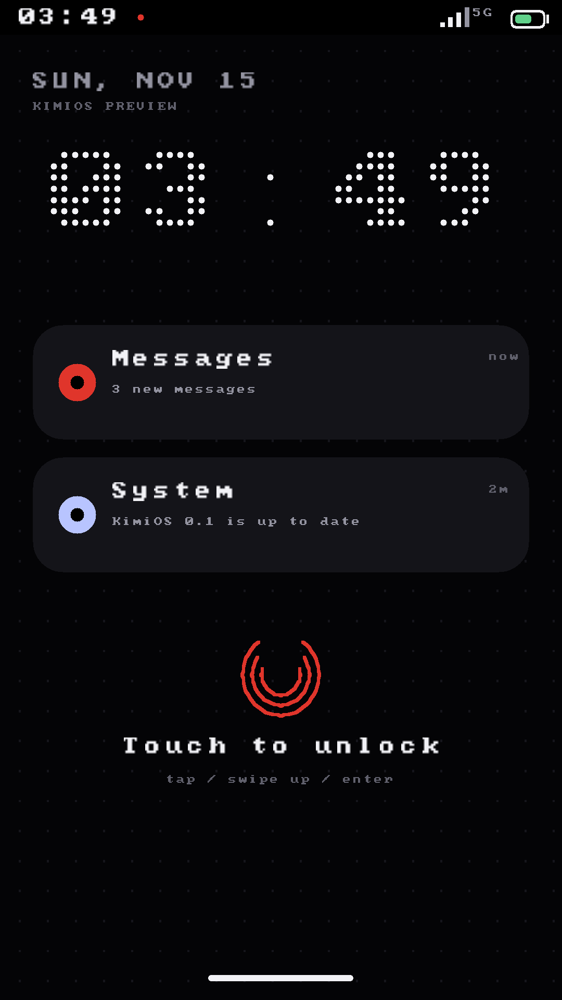

# KimiOS

A phone OS written in Rust whose **entire userland runs natively on iOS and
Android** — no emulator, no VM. The same code also boots as a bare-metal ARM64
kernel on QEMU. One codebase, three ways to run it.

KimiOS began as a from-scratch `#![no_std]` `#![no_main]` operating system for
AArch64. The phone GUI, apps and shell it grew are pure computation over a
framebuffer with a tiny syscall surface — which turned out to be exactly what a
**library-OS** needs. So the userland now ships as a native ARM64 library hosted
by a thin platform shell on real devices, at native speed, with no QEMU in the
loop.

| Lock screen | Home | Quick settings |
|:---:|:---:|:---:|
|  |  |  |

| Terminal | Calculator | Settings |
|:---:|:---:|:---:|
|  |  |  |

## One userland, three ways to run it

| Mode | What runs | How | Status |
|---|---|---|---|
| **iOS library-OS** | GUI + apps + shell, native ARM64 | Rust staticlib + Swift/UIKit/Metal shell → `.ipa` | builds in CI, fully functional |
| **Android library-OS** | GUI + apps + shell, native ARM64 | Rust staticlib + C/JNI + Java/SurfaceView shell → APK | builds in CI, signed, fully functional |
| **Bare-metal kernel** | full OS (EL1 kernel + EL0 userland) | boots on QEMU `virt` (`-kernel` ELF) | working dev target |

The library-OS ports are the headline: KimiOS running directly on a phone/tablet
CPU, rendering through Metal (iOS) or an `ANativeWindow` framebuffer (Android),
with the host's filesystem and sockets. The bare-metal kernel is the foundation
the userland was built on, and still runs the whole OS under QEMU.

## The library-OS insight

The userland (`user/libkimi` + `user/kimi-gui` + apps + shell) is `no_std` with
**no allocator**. It touches the OS through only three primitives in
[`user/libkimi/src/lib.rs`](user/libkimi/src/lib.rs), gated by
`cfg(target_os = "none")`:

- `syscall3/4/5` — `svc #0` trap to the kernel, **or** a call to a host
  `kimi_host_syscall(number, a0..a4)` dispatcher.
- `cntpct()` — `mrs cntpct_el0`, **or** `kimi_host_cntpct()`.
- `exit()` — `wfe` park, **or** host `SYS_EXIT`.

Everything above those three lines is **byte-for-byte identical** across bare
metal, iOS and Android. A host implements the dispatcher with platform APIs:

```text
                 kimi-gui + apps + shell + libkimi   (one pure-Rust userland)
                                   |
                    kimi_host_syscall(n, a0..a4)      (C ABI; cfg host)
          ┌────────────────────────┼────────────────────────┐
   iOS shell (Swift)        Android shell (C/JNI)     bare-metal kernel
   Metal framebuffer        ANativeWindow fb          EL1, MMU, virtio
   UIKit touches            JNI touches               svc #0 trap
   sandbox FS, BSD sockets  sandbox FS, BSD sockets   KimiFS, smoltcp
   mach time                clock_gettime             CNTPCT, PL031
```

Because the GUI is just pixels + events + a handful of services, porting it is
implementing that one dispatcher — not rewriting the OS.

## Get KimiOS

Both device builds are produced by GitHub Actions and attached to draft releases:

- **iOS** — [`ios/`](ios/README.md), workflow `ios.yml` (`macos-latest`) →
  unsigned `KimiOS-iPad-v0.9.0.ipa`. Install with Sideloadly / AltStore /
  StikDebug (re-signs with your Apple ID). iOS 15+, portrait.
- **Android** — [`android/`](android/README.md), workflow `android-libos.yml`
  (`ubuntu`) → `KimiOS-Android-libOS-v0.9.0.apk`, signed with the **same debug key
  as the phone** (cert SHA-256 `b1339cd3…`). `adb install -r` or sideload.
  Android 8.0+ (API 26), arm64, portrait.

```bash
GH_TOKEN=… gh workflow run ios.yml           --repo Kimi-syl/kimios
GH_TOKEN=… gh workflow run android-libos.yml --repo Kimi-syl/kimios
```

## What's inside (the userland)

A Nothing-OS × Material-3 phone shell, all software-rendered in Rust at
1080×1920 (logical 480×800), double-buffered with dirty-rect present:

- Lock screen, status bar, Quick Settings shade, 12-app paged launcher + dock,
  Nothing typefaces (NType82 / Ndot-55 / NType82Mono), on-screen keyboard.
- Interactive apps: Phone, Messages, Camera (saves PPM), Music, Clock,
  Calculator, Notes, Maps, Photos, Files, Weather, **Terminal**, **Browser**,
  APK inspector, mini-Dalvik DEX runner.
- A shared command interpreter (`libkimi::shell`) used by both the CLI and the
  in-GUI Terminal: `ls cat write rm mkdir rmdir mv stat df net dns fetch date
  time sleep uptime ps kpkg apk dvm …`.
- **kpkg** (apt-like package manager), an **APK inspector** (ZIP/DEFLATE/binary
  AXML/DEX), and a bounded **mini-Dalvik** DEX interpreter.

On the device ports the filesystem is the app sandbox (`/disk/` persists), and
networking is real DNS + TCP (Browser, `dns`, `fetch`, kpkg all work).

## Building

### Device library-OS (recommended)

```bash
bash ios/build-ipa.sh      # macOS + Xcode + Rust + xcodegen → .ipa
bash android/build-apk.sh  # JDK 17 + Android SDK/NDK + Rust → signed APK
```

Both scripts also run unchanged in CI. The Android script auto-detects the phone
build host (`/opt/tusr` toolchain) vs CI (NDK).

### Bare-metal kernel (QEMU)

```bash
rustup target add aarch64-unknown-none
cargo build --release                 # target preset in .cargo/config.toml
truncate -s 4M disk.img               # optional persistent disk

qemu-system-aarch64 -machine virt,gic-version=3 -cpu cortex-a53 -m 128M \
  -semihosting-config enable=on,target=native -dtb virt.dtb \
  -drive if=none,format=raw,file=disk.img,id=hd0 -device virtio-blk-device,drive=hd0 \
  -device ramfb -device virtio-keyboard-device -device virtio-tablet-device \
  -display none -vnc 127.0.0.1:0 -serial stdio \
  -kernel target/aarch64-unknown-none/release/kimios
```

The GUI starts at boot; tap/swipe/Enter unlocks, ESC returns to the shell.
`build.rs` builds the `user/` workspace and embeds the binaries into the kernel
RamFS. Resolution via `-append "kimios.fb=1080x1920"`, backend via
`kimios.gpu=auto|ramfb|virtio`.

## The bare-metal foundation

The kernel (`src/`, EL1) the userland was built on:

- **Boot/CPU:** EL1 entry (drops EL2→EL1 for UTM), PL011 UART, exception vectors,
  MMU identity map (≤4 GiB), DTB parse, bitmap frame allocator, GICv3 + generic
  timer, PSCI secondary bring-up (`-smp 4`).
- **Processes:** private TTBR0 address spaces, preemptive round-robin EL0
  scheduling (50 ms), `spawn`/`exec`/`wait`/`ps`/`kill` (no `fork`), blocking
  console read, per-process `brk` heaps + a user `GlobalAlloc`.
- **Storage:** virtio-blk (legacy + modern mmio) and **KimiFS** (directories,
  rename, stat, free-space reuse, ≤64 GiB); `/disk/` survives reboots.
- **Networking:** virtio-net + smoltcp (Ethernet/ARP/IPv4/ICMP/UDP/TCP), DHCP,
  DNS, TCP socket API.
- **Graphics:** hardware-independent `fb_info`/`fb_back`/`fb_present`; backend
  dispatch (ramfb stable, VirtIO-GPU 2D implemented).
- **Loaders:** native KimiOS ELF, static Linux ELF (a Linux ABI translation
  layer, `src/linux.rs`), and PE32+ with translated `kernel32` imports.

Full per-phase history: **[docs/phases.md](docs/phases.md)**.

## How we got here

1. **Bare-metal kernel + phone GUI** (Ph1–44): a working ARM64 OS on QEMU with a
   Nothing-style phone UI, real apps, storage and networking.
2. **Android APK compatibility — abandoned.** An APK inspector and mini-Dalvik
   were built and verified, but running Play-Store apps needs the full Android
   runtime (Bionic/ART/framework/Binder) — team-scale. See
   [docs/android-feasibility.md](docs/android-feasibility.md).
3. **"Desktop Lite" (Ph47+):** a WSL1-style Linux syscall-translation layer ran
   static Linux binaries (BusyBox, musl/glibc) on the kernel, with kpkg. This
   proved the userland could host real binaries — but still inside QEMU.
4. **Library-OS (current):** the same userland compiled as a native library and
   hosted directly by iOS/Android. No QEMU, native speed, real device FS/net.
   The QEMU frontend ([kimios-android](https://github.com/Kimi-syl/kimios-android))
   remains as the full-kernel emulation path.

## Status and honest caveats

- **Library-OS ports build and are functionally complete** (FS, net, all apps),
  verified end-to-end natively (real shell, DNS, HTTP fetch; GUI render + touch
  via a host harness) and in CI. On-device runtime verification is pending
  hardware access (no test device attached); the contract is proven, the Swift /
  JNI shells are standard platform code.
- **External binaries on device:** `spawn`/`run`/`exec` of external ELF/PE needs
  a JIT ELF loader (mode B) — not yet built. Everything compiled-in runs
  ahead-of-time at native speed. APKs are inspected (not executed); DEX runs on
  the built-in mini-Dalvik, exactly as on bare metal.
- **Bare metal on real silicon** (Redmi Note 11, `spes`) is blocked: locked
  bootloader, boot chain not dumped/verified. QEMU `virt` is the working kernel
  target. See [docs/hardware.md](docs/hardware.md).
- **Legacy QEMU-era limits** (still true for the kernel path): VirtIO-GPU 2D
  falls back to ramfb on tested QEMU; the Linux ABI has no `fork`/`execve`
  (individual BusyBox applets work, interactive `sh` doesn't); Linux binaries
  must be static non-PIE; SMP is bring-up only. These motivated the library-OS
  pivot — on a real device the host OS provides all of this.

## Documentation

- [ios/README.md](ios/README.md) — iOS library-OS port; `.ipa` CI; host dispatcher.
- [android/README.md](android/README.md) — Android library-OS port; signed APK CI.
- [docs/phases.md](docs/phases.md) — detailed write-up of every phase (Ph1–Ph52).
- [ROADMAP.md](ROADMAP.md) — milestone checklist across the three modes.
- [docs/graphics-architecture.md](docs/graphics-architecture.md) — display
  backends, VirtIO-GPU status, benchmarks.
- [docs/android-feasibility.md](docs/android-feasibility.md) — why APK
  compatibility was abandoned; the mini-Dalvik scope shipped.
- [docs/hardware.md](docs/hardware.md) — Redmi Note 11 (spes) hardware profile.
- [kimios-android](https://github.com/Kimi-syl/kimios-android) — the QEMU
  frontend (full-kernel emulation, bundled QEMU, VNC/ashmem display).
