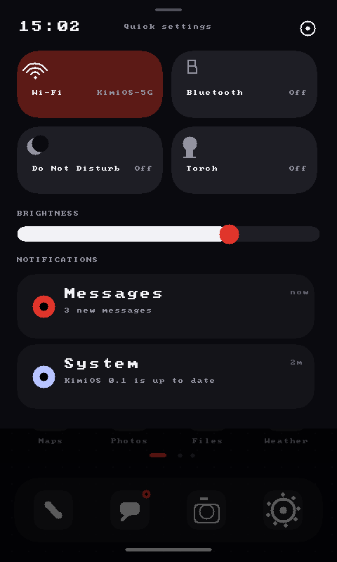
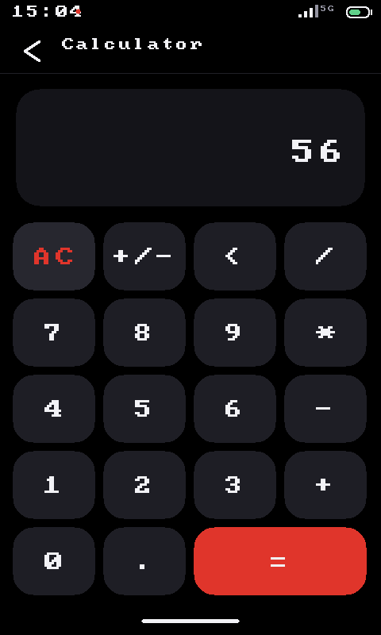
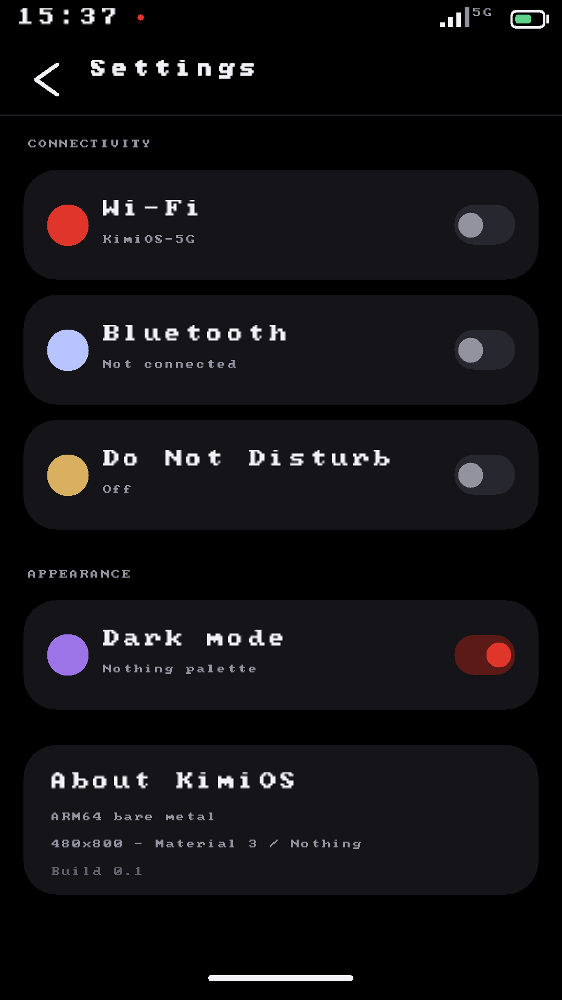

# KimiOS

A bare-metal operating system for ARM64 (AArch64), written in Rust with
`#![no_std]` and `#![no_main]`. It boots on QEMU's `virt` machine (no
bootloader: QEMU loads the ELF directly with `-kernel`) and presents a
Nothing-OS x Material-3 phone GUI. A companion Android app,
[kimios-android](https://github.com/Kimi-syl/kimios-android), runs the whole
OS on a phone inside bundled QEMU.

| Lock screen | Home | Quick settings |
|:---:|:---:|:---:|
|  |  |  |

| Terminal | Calculator | Settings |
|:---:|:---:|:---:|
|  |  |  |

The GUI starts automatically at boot. Tap, swipe up, or press Enter/Space/Up
to unlock; ESC returns to the text shell (`run /gui` starts it again). Every
launcher app is interactive, including the in-phone Terminal.

## The pivot: "Desktop Lite", not Android

KimiOS originally aimed at Android APK compatibility. That path was explored
and then **abandoned**: an APK inspector (Ph45) and a mini-Dalvik DEX
interpreter (Ph46) were built and verified, but running real Play-Store apps
requires the full Android runtime — Bionic, ART/libcore, the framework,
Binder — which is team-scale. The full analysis is in
[docs/android-feasibility.md](docs/android-feasibility.md).

Since Ph47 KimiOS is a **"Desktop Lite" environment in the WSL1 model**: a
Linux ABI syscall-translation layer ([src/linux.rs](src/linux.rs)) runs
standard **statically-linked Linux binaries** (musl/glibc) and native Rust
apps directly on the KimiOS kernel — no Linux kernel, no VM inside the VM.

- `run /disk/<binary>` executes a static Linux ELF (loaded at its own link
  address, with a real argc/argv/envp/auxv stack).
- **kpkg** (Ph48) is an apt-like package manager: `kpkg update`, `kpkg list`,
  `kpkg install <name>`, `kpkg run <name>` — HTTP downloads over the built-in
  TCP/IP stack, binaries land in `/disk/bin`.
- **BusyBox** (Ph49): a static 402-applet build runs on the guest, e.g.
  `run /disk/busybox ls -l` or `kpkg run busybox cat /motd`.
- Boot to init takes **~0.4 s** (the legacy boot demos were trimmed).

## Key features

- **Kernel:** EL1 boot, PL011 UART, AArch64 exception vectors, MMU identity
  map (up to 4 GiB RAM), DTB parsing, bitmap physical-frame allocator, GICv3 +
  generic timer, PSCI secondary-CPU bring-up (`-smp 4`).
- **Processes:** per-process address spaces (private TTBR0), preemptive
  round-robin EL0 scheduling (50 ms quantum), `spawn`/`exec`/`wait`/`ps`/
  `kill` (spawn-based; no `fork`), blocking console read, sleep/uptime,
  per-process heaps (`brk`) and a user-space `GlobalAlloc`.
- **Storage:** virtio-blk (legacy + modern virtio-mmio) and **KimiFS**, a
  persistent on-disk filesystem with directories, rename, stat and
  free-space reuse (up to 64 GiB disks). Files under `/disk/` survive reboots.
- **Networking:** virtio-net + smoltcp (Ethernet/ARP/IPv4/ICMP/UDP/TCP),
  DHCP, DNS (public resolvers first, 3-server fallback), TCP socket API, and
  a mini in-GUI web browser (HTTP/1.0, HTML-to-text).
- **Phone GUI:** lock screen, status bar, Quick Settings shade, 12-app
  launcher with paging, Nothing OS typefaces (NType82 / Ndot-55 /
  NType82Mono), all software-rendered in user space. Double-buffered with
  dirty-rect present, instant press feedback and an 8 ms input poll.
- **Graphics:** hardware-independent display interface — the GUI renders to
  a back buffer and publishes via `fb_info`/`fb_back`/`fb_present`; the kernel
  dispatches to a backend chosen by `kimios.gpu=` (auto/ramfb/virtio). A
  VirtIO-GPU 2D driver exists; ramfb is the stable fallback (see status).
- **Binary formats:** native KimiOS ELF, static Linux ELF (Linux ABI), and a
  PE32+ loader with 9 translated `kernel32.dll` imports (a generated
  `hello.exe` runs at EL0).

## Architecture

```text
QEMU virt (or Android frontend's bundled QEMU)
  |  ramfb / VirtIO-GPU 2D, virtio-blk/net/keyboard/tablet, PL011, PL031, GICv3
  v
kernel (src/, EL1)
  boot.s vectors.s main.rs      entry, exceptions, kmain
  mmu.rs pfa.rs allocator.rs    identity map, frames, 8 MiB kernel heap
  dtb.rs gic.rs timer.rs irq.rs device tree, interrupts
  process.rs sched.rs elf.rs pe.rs   processes, loaders (ELF/PE/Linux)
  linux.rs                      Linux ABI syscall translation (the pivot)
  ramfs.rs block.rs virtio_blk.rs diskfs.rs   VFS + KimiFS
  net.rs virtio_net.rs          smoltcp networking
  fb.rs virtio_gpu.rs input.rs  display backends, input event ring
  v
user space (user/, EL0)
  libkimi    syscall wrappers, Heap, kpkg, apk inspector, mini-Dalvik (dvm)
  kimi-init  PID 1: boots /gui, falls back to the text shell
  kimi-gui   the phone UI (draw.rs renderer, apps.rs, Nothing fonts)
  test binaries: hello, fstest, spin, fbtest, gfxtest, inputtest, stress, ...
```

`build.rs` builds the whole `user/` workspace (separate target dir) and
embeds the binaries into the kernel's RamFS; it also generates `hello.exe`.
Full per-phase history and design notes: **[docs/phases.md](docs/phases.md)**.

## Build and run

Prerequisites:

```bash
rustup target add aarch64-unknown-none
# Debian / Kali: qemu-system-aarch64 lives in qemu-system-arm
sudo apt install qemu-system-arm
```

Build (the target is preset in `.cargo/config.toml`):

```bash
cargo build --release

# Optional 4 MiB disk image. Without it the kernel runs from RamFS only.
truncate -s 4M disk.img
```

Headless run (text shell; `init` prints `gui: no framebuffer` and continues):

```bash
qemu-system-aarch64 \
  -machine virt,gic-version=3 \
  -cpu cortex-a53 \
  -m 128M \
  -nographic \
  -semihosting-config enable=on,target=native \
  -dtb virt.dtb \
  -drive if=none,format=raw,file=disk.img,id=hd0 \
  -device virtio-blk-device,drive=hd0 \
  -kernel target/aarch64-unknown-none/release/kimios
```

For the phone GUI add `-device ramfb -device virtio-keyboard-device
-device virtio-tablet-device`. With no X/Wayland session (e.g. proot on a
phone), use QEMU's VNC server instead of GTK:

```bash
qemu-system-aarch64 \
  -machine virt,gic-version=3 -cpu cortex-a53 -m 128M \
  -semihosting-config enable=on,target=native -dtb virt.dtb \
  -drive if=none,format=raw,file=disk.img,id=hd0 \
  -device virtio-blk-device,drive=hd0 \
  -device ramfb -device virtio-keyboard-device -device virtio-tablet-device \
  -display none -vnc 127.0.0.1:0 -serial stdio \
  -kernel target/aarch64-unknown-none/release/kimios
```

Notes:

- Release builds are much faster than debug at 1080p. `-smp 4` exercises the
  PSCI bring-up; `-global virtio-mmio.force-legacy=false` exercises the
  modern virtio transport (both are supported).
- Display resolution can be set with `-append "kimios.fb=1080x1920"`;
  backend preference with `-append "kimios.gpu=ramfb"` (auto/ramfb/virtio).
- The checked-in `virt.dtb` is trimmed for `-m 128M`; regenerate after
  changing `-m`/`-smp`:
  `qemu-system-aarch64 -machine virt,dumpdtb=virt.dtb -m 128M -nographic`.

### Using Desktop Lite

In the shell (or the in-GUI Terminal):

```text
$ kpkg update                 # fetch repo.json (default http://10.0.2.2:8080)
$ kpkg install busybox        # download a static binary to /disk/bin
$ kpkg run busybox ls -l      # run it through the Linux ABI
$ run /disk/busybox uname -a  # same thing, directly
$ dns example.com             # networking helpers: net / dns / fetch
```

With QEMU user-mode networking (`-netdev user,id=n0 -device
virtio-net-device,netdev=n0`) the guest reaches the host loopback at
`10.0.2.2`; the Android frontend serves its bundled kpkg repo there.

## Current status and honest caveats

- **QEMU `virt` is the working target.** Bare metal (Redmi Note 11, `spes`)
  is blocked: locked bootloader, stock boot chain not yet dumped/verified.
  See [docs/hardware.md](docs/hardware.md) and [ROADMAP.md](ROADMAP.md).
- **VirtIO-GPU 2D is implemented but blocked on tested QEMU builds:**
  `RESOURCE_ATTACH_BACKING` returns `ERR_UNSPEC` (host 11.1.2 and bundled
  10.2.1), so the kernel auto-falls back to ramfb. Details and the next
  debugging step: [docs/graphics-architecture.md](docs/graphics-architecture.md).
- **No `fork`/`execve` in the Linux ABI:** individual BusyBox applets work,
  but interactive `busybox sh` does not. Threads/futex/epoll/dlopen and
  Linux-side sockets are also unimplemented — npm/pip/TLS-curl are marked
  not-runnable in the kpkg repo.
- **Linux binaries must be static, non-PIE** (musl/glibc static, linked at
  e.g. `0x40_0000`). Dynamic linking is not supported.
- SMP is bring-up only: scheduling, timer and EL0 run on CPU 0; secondaries
  park in `wfe`. Syscalls execute with IRQs masked.
- **Display latency:** `gfxbench` (SYS 38) measures ramfb full-frame present
  ~15.6 ms vs ~0.44 ms for a 256 px dirty rect under TCG (~35x cheaper). The
  remaining end-to-end bottleneck is the VNC transport; the real lever is an
  ashmem shared-memory framebuffer, in progress in the Android frontend
  ([display-pipeline.md](https://github.com/Kimi-syl/kimios-android/blob/main/docs/display-pipeline.md)).

## Documentation

- [docs/phases.md](docs/phases.md) — detailed write-up of every phase (Ph1-Ph52).
- [ROADMAP.md](ROADMAP.md) — terse milestone checklist (QEMU vs bare metal).
- [docs/graphics-architecture.md](docs/graphics-architecture.md) — display
  backends, VirtIO-GPU status, benchmarks, acceleration staging.
- [docs/android-feasibility.md](docs/android-feasibility.md) — why APK
  compatibility was abandoned; the mini-Dalvik scope that was shipped.
- [docs/hardware.md](docs/hardware.md) — Redmi Note 11 (spes) hardware profile.
- [kimios-android](https://github.com/Kimi-syl/kimios-android) — the Android
  frontend (bundled QEMU 10.2.1, VNC display, local kpkg repo server).
