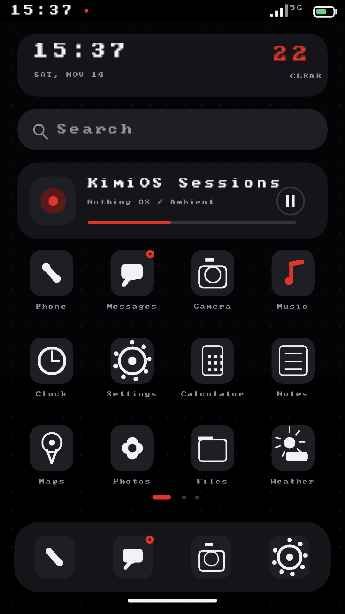
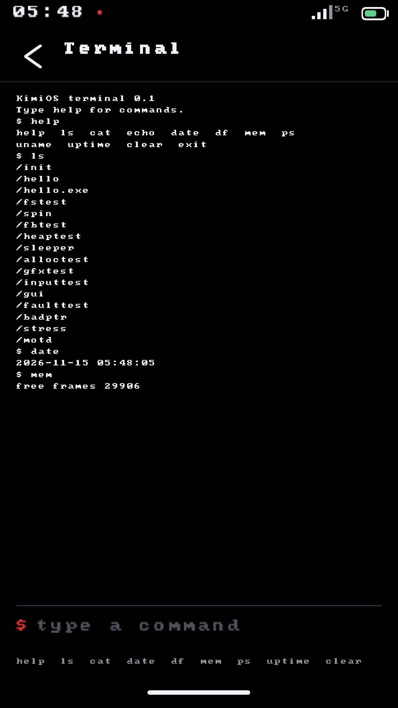

# KimiOS

A **Desktop Lite** environment for phones: a WSL1-style layer that runs standard
statically-linked Linux binaries and native apps directly on the device — no
Linux kernel, no VM. The goal has stayed the same; the means got much more
efficient. Instead of emulating a bare-metal kernel under QEMU, the userland now
runs **natively on iOS and Android as a library-OS**, at native speed.

KimiOS began as a from-scratch `#![no_std]` `#![no_main]` ARM64 kernel with a
Nothing-OS × Material-3 phone GUI. That userland is pure computation over a
framebuffer with a tiny syscall surface — exactly what a library-OS needs — so it
now ships as a native ARM64 library hosted by a thin platform shell on real
devices. The same code still boots as a bare-metal kernel on QEMU. One codebase,
three ways to run it.

| Lock screen | Home | Quick settings |
|:---:|:---:|:---:|
|  |  |  |

| Terminal | Calculator | Settings |
|:---:|:---:|:---:|
|  |  |  |

## One userland, three ways to run it

| Mode | What runs | How | Status |
|---|---|---|---|
| **iOS library-OS** | GUI + apps + shell, native ARM64 | Rust staticlib + Swift/UIKit/Metal shell → `.ipa` | builds in CI, fully functional |
| **Android library-OS** | GUI + apps + shell, native ARM64 | Rust staticlib + C/JNI + Java/SurfaceView shell → APK | builds in CI, signed, fully functional |
| **Bare-metal kernel** | full OS (EL1 kernel + EL0 userland) | boots on QEMU `virt` (`-kernel` ELF) | working dev target |

The library-OS ports are how Desktop Lite ships today: KimiOS running directly on
a phone/tablet CPU, rendering through Metal (iOS) or an `ANativeWindow`
framebuffer (Android), with the host's filesystem and sockets. The bare-metal
kernel is the foundation the userland was built on, and still runs the whole OS
under QEMU.

## The goal: Desktop Lite — without QEMU

Desktop Lite is the WSL1 model: translate a binary's syscalls onto a host layer
rather than running a full kernel/VM. KimiOS first proved this on the bare-metal
kernel — `src/linux.rs` translates Linux syscall numbers so static musl/glibc
binaries and BusyBox run at EL0 (`run /disk/<binary>`, `kpkg run busybox …`).
That works, but it pays QEMU emulation overhead and a display-transport latency
floor on every frame and every touch.

The library-OS does the **same thing far more efficiently** — and on Android it
is **done**. The key realization: an Android app already runs on a real aarch64
**Linux kernel**, so a musl-linked Linux binary's `svc #0` syscalls are serviced
by the device kernel *natively* (threads, futex, epoll, sockets, `mprotect`,
`dlopen`, `/proc` — no emulation, no `svc` rewriting). The libOS only needs to
**load** the binary and jump to it: `android/jni/kimi_elf.c` forks a child, maps
the dynamic musl ELF + `ld-musl` interpreter with `mmap(NULL)`, builds a SysV
auxv/stack, and enters the interpreter. Three platform mitigations make it work
(a SIGSYS→ENOSYS seccomp shim, targetSdk 28 for W^X, 4 KiB pages). **CPython
3.14 and Node.js 24 execute on the real device** at native speed. Full design +
the bionic-sigchain/TLS bug that blocked Node:
[docs/desktop-lite-native.md](docs/desktop-lite-native.md). iOS guest execution
is the remaining port (no `fork`, stricter JIT). The terminal's VT/ANSI renderer
and key UI are shared with the `.ipa`; PTY-backed OpenCode/vim/htop sessions are
Android-only until an iOS guest runner exists.

**Alpine `apk` compatibility:** kpkg also speaks Alpine's package format via
`apkg` (`apkg update / info / install <name>`): it parses APKINDEX repos and `.apk`
packages (multi-member gzip + tar), resolves `so:` dependencies, preserves
symlinks (`SYS_SYMLINK`), and streams packages into a sandbox sysroot — verified
by installing **nodejs** and **python3** (real aarch64 musl binaries) with their
full dependency closures from the live Alpine repo, then **running** them
natively. See [market/README.md](market/README.md).

## The library-OS insight

The userland (`user/libkimi` + `user/kimi-gui` + apps + shell) is `no_std` with
**no allocator**. It touches the OS through only three primitives in
[`user/libkimi/src/lib.rs`](user/libkimi/src/lib.rs), gated by
`cfg(target_os = "none")`:

- `syscall3/4/5` — `svc #0` trap to the kernel, **or** a call to a host
  `kimi_host_syscall(number, a0..a4)` dispatcher.
- `cntpct()` — `mrs cntpct_el0`, **or** `kimi_host_cntpct()`.
- `exit()` — `wfe` park, **or** host `SYS_EXIT`.

Everything above those three lines is **byte-for-byte identical** across bare
metal, iOS and Android. A host implements the dispatcher with platform APIs:

```text
                 kimi-gui + apps + shell + libkimi   (one pure-Rust userland)
                                   |
                    kimi_host_syscall(n, a0..a4)      (C ABI; cfg host)
          ┌────────────────────────┼────────────────────────┐
   iOS shell (Swift)        Android shell (C/JNI)     bare-metal kernel
   Metal framebuffer        ANativeWindow fb          EL1, MMU, virtio
   UIKit touches            JNI touches               svc #0 trap
   sandbox FS, BSD sockets  sandbox FS, BSD sockets   KimiFS, smoltcp
   mach time                clock_gettime             CNTPCT, PL031
```

Because the GUI is just pixels + events + a handful of services, porting it is
implementing that one dispatcher — not rewriting the OS.

## Get KimiOS

Both device builds are produced by GitHub Actions and attached to draft releases:

- **iOS** — [`ios/`](ios/README.md), workflow `ios.yml` (`macos-latest`) →
  unsigned `KimiOS-iPad-v0.9.0.ipa`. Install with Sideloadly / AltStore /
  StikDebug (re-signs with your Apple ID). iOS 15+, portrait.
- **Android** — [`android/`](android/README.md), workflow `android-libos.yml`
  (`ubuntu`) → `KimiOS-Android-libOS-v0.9.0.apk`, signed with the **same debug key
  as the phone** (cert SHA-256 `b1339cd3…`). `adb install -r` or sideload.
  Android 8.0+ (API 26), arm64, portrait.

```bash
GH_TOKEN=… gh workflow run ios.yml           --repo Kimi-syl/kimios
GH_TOKEN=… gh workflow run android-libos.yml --repo Kimi-syl/kimios
```

## What's inside (the userland)

A Nothing-OS × Material-3 phone shell, all software-rendered in Rust at
1080×1920 (logical 480×800), double-buffered with dirty-rect present:

- Lock screen, status bar, Quick Settings shade, 12-app paged launcher + dock,
  Nothing typefaces (NType82 / Ndot-55 / NType82Mono), on-screen keyboard.
- Interactive apps: Phone, Messages, Camera (saves PPM), Music, Clock,
  Calculator, Notes, Maps, Photos, Files, Weather, **Terminal**, **Browser**,
  **Marketplace**, APK inspector, mini-Dalvik DEX runner.
- **Marketplace** (powered by kpkg): browse and install **themes**, **fonts** and
  apps. Seven built-in themes (Nothing Dark, Graphite Light, Ocean, Forest,
  Sunset, Lavender, Mono) and four fonts (NType82, Ndot-55, Mono, Pixel 8x8) apply
  live and persist; more download from a [`market/`](market/README.md) repo
  (`.theme` palettes, `.kfont` bitmap fonts). The whole UI recolours/re-types at
  runtime via a global palette + selectable font.
- A shared command interpreter (`libkimi::shell`) used by both the CLI and the
  in-GUI Terminal: `ls cat write rm mkdir rmdir mv stat df net dns fetch date
  time sleep uptime ps kpkg apk dvm …`.
- **kpkg** (apt-like package manager), an **APK inspector** (ZIP/DEFLATE/binary
  AXML/DEX), and a bounded **mini-Dalvik** DEX interpreter.

On the device ports the filesystem is the app sandbox (`/disk/` persists), and
networking is real DNS + TCP (Browser, `dns`, `fetch`, kpkg all work).

## Building

### Device library-OS (recommended)

```bash
bash ios/build-ipa.sh      # macOS + Xcode + Rust + xcodegen → .ipa
bash android/build-apk.sh  # JDK 17 + Android SDK/NDK + Rust → signed APK
```

Both scripts also run unchanged in CI. The Android script auto-detects the phone
build host (`/opt/tusr` toolchain) vs CI (NDK).

### Bare-metal kernel (QEMU)

```bash
rustup target add aarch64-unknown-none
cargo build --release                 # target preset in .cargo/config.toml
truncate -s 4M disk.img               # optional persistent disk

qemu-system-aarch64 -machine virt,gic-version=3 -cpu cortex-a53 -m 128M \
  -semihosting-config enable=on,target=native -dtb virt.dtb \
  -drive if=none,format=raw,file=disk.img,id=hd0 -device virtio-blk-device,drive=hd0 \
  -device ramfb -device virtio-keyboard-device -device virtio-tablet-device \
  -display none -vnc 127.0.0.1:0 -serial stdio \
  -kernel target/aarch64-unknown-none/release/kimios
```

The GUI starts at boot; tap/swipe/Enter unlocks, ESC returns to the shell.
`build.rs` builds the `user/` workspace and embeds the binaries into the kernel
RamFS. Resolution via `-append "kimios.fb=1080x1920"`, backend via
`kimios.gpu=auto|ramfb|virtio`.

## The bare-metal foundation

The kernel (`src/`, EL1) the userland was built on:

- **Boot/CPU:** EL1 entry (drops EL2→EL1 for UTM), PL011 UART, exception vectors,
  MMU identity map (≤4 GiB), DTB parse, bitmap frame allocator, GICv3 + generic
  timer, PSCI secondary bring-up (`-smp 4`).
- **Processes:** private TTBR0 address spaces, preemptive round-robin EL0
  scheduling (50 ms), `spawn`/`exec`/`wait`/`ps`/`kill` (no `fork`), blocking
  console read, per-process `brk` heaps + a user `GlobalAlloc`.
- **Storage:** virtio-blk (legacy + modern mmio) and **KimiFS** (directories,
  rename, stat, free-space reuse, ≤64 GiB); `/disk/` survives reboots.
- **Networking:** virtio-net + smoltcp (Ethernet/ARP/IPv4/ICMP/UDP/TCP), DHCP,
  DNS, TCP socket API.
- **Graphics:** hardware-independent `fb_info`/`fb_back`/`fb_present`; backend
  dispatch (ramfb stable, VirtIO-GPU 2D implemented).
- **Loaders:** native KimiOS ELF, static Linux ELF (a Linux ABI translation
  layer, `src/linux.rs`), and PE32+ with translated `kernel32` imports.

Full per-phase history: **[docs/phases.md](docs/phases.md)**.

## How we got here

1. **Bare-metal kernel + phone GUI** (Ph1–44): a working ARM64 OS on QEMU with a
   Nothing-style phone UI, real apps, storage and networking.
2. **Android APK compatibility — abandoned.** An APK inspector and mini-Dalvik
   were built and verified, but running Play-Store apps needs the full Android
   runtime (Bionic/ART/framework/Binder) — team-scale. See
   [docs/android-feasibility.md](docs/android-feasibility.md).
3. **Desktop Lite adopted as the goal (Ph47+).** A WSL1-style Linux
   syscall-translation layer ran static Linux binaries (BusyBox, musl/glibc) on
   the kernel, with kpkg — proving the model. This first implementation ran
   inside QEMU, with the emulation and display-latency costs that come with it.
4. **Library-OS — Desktop Lite done efficiently (current).** The same userland
   compiled as a native library and hosted directly by iOS/Android: no QEMU,
   native speed, real device FS/net. The JIT ELF loader + host-side Linux syscall
   translation bring the Desktop Lite binary-hosting capability natively to the
   device. The QEMU frontend
   ([kimios-android](https://github.com/Kimi-syl/kimios-android)) remains as the
   full-kernel emulation path and the proving ground for the Linux ABI.

## Status and honest caveats

- **Library-OS ports build and are functionally complete** (FS, net, all apps),
  verified end-to-end natively (real shell, DNS, HTTP fetch; GUI render + touch)
  and in CI. **Android is verified on real hardware** (Andarium, SDK 37: GUI
  render+touch and native Linux guests). iOS on-device verification is pending
  hardware.
- **Desktop Lite on device — DONE on Android.** Real dynamic musl Linux binaries
  (CPython 3.14, Node.js 24) execute natively via a forked-child ELF loader on the
  device kernel — no QEMU, no ABI emulation
  ([docs/desktop-lite-native.md](docs/desktop-lite-native.md)). iOS guest
  execution is the remaining port. Everything compiled-in (GUI, apps, shell) runs
  ahead-of-time at native speed. APKs are inspected (not executed); DEX runs on
  the built-in mini-Dalvik, exactly as on bare metal.
- **Bare metal on real silicon** (Redmi Note 11, `spes`) is blocked: locked
  bootloader, boot chain not dumped/verified. QEMU `virt` is the working kernel
  target. See [docs/hardware.md](docs/hardware.md).
- **QEMU-implementation limits** (kernel path): VirtIO-GPU 2D falls back to ramfb
  on tested QEMU; the Linux ABI has no `fork`/`execve` (individual BusyBox applets
  work, interactive `sh` doesn't); Linux binaries must be static non-PIE; SMP is
  bring-up only. These are the costs of doing Desktop Lite under QEMU — the
  library-OS avoids them, since the host OS supplies real threads, sockets,
  dynamic linking and storage.

## Documentation

- [ios/README.md](ios/README.md) — iOS library-OS port; `.ipa` CI; host dispatcher.
- [android/README.md](android/README.md) — Android library-OS port; signed APK CI.
- [market/README.md](market/README.md) — Marketplace repo: themes, fonts, apps;
  asset formats (`.theme`, `.kfont`) and serving.
- [docs/phases.md](docs/phases.md) — detailed write-up of every phase (Ph1–Ph52).
- [ROADMAP.md](ROADMAP.md) — milestone checklist across the three modes.
- [docs/graphics-architecture.md](docs/graphics-architecture.md) — display
  backends, VirtIO-GPU status, benchmarks.
- [docs/android-feasibility.md](docs/android-feasibility.md) — why APK
  compatibility was abandoned; the mini-Dalvik scope shipped.
- [docs/hardware.md](docs/hardware.md) — Redmi Note 11 (spes) hardware profile.
- [kimios-android](https://github.com/Kimi-syl/kimios-android) — the QEMU
  frontend (full-kernel emulation, bundled QEMU, VNC/ashmem display).
